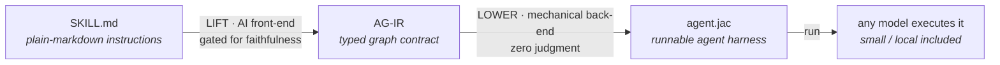

## Two ways in

- **Use it** — install the release and drive the `sigil` CLI. See [Install](#install).
- **Read / hack it** — clone and run the tree from source, with step-by-step
  dumpers, breakpoints, and a visual pipeline explorer. See
  [Run from source](#run-from-source--watch-every-stage).

## Install

```bash
curl -fsSL https://github.com/sigilagent/sigil/releases/latest/download/install.sh | bash
# or
npm install -g @sigilagent/sigil
```

macOS and Linux. Both land the same release in `~/.sigil/app`: the npm package is a
launcher whose first run performs that install, pinned to the package's version, so
`npm update -g @sigilagent/sigil` is how an npm install moves to the next release.

On Windows, run this in PowerShell:

```powershell
irm https://github.com/sigilagent/sigil/releases/latest/download/install.ps1 | iex
```

jac has no Windows build yet, so Sigil runs in Docker Desktop or WSL2, and you get a
`sigil` command that forwards to it. See [docs/reference/windows.md](docs/reference/windows.md).

The installer compiles Sigil once, so the first command starts warm. On a fresh
install at a terminal it then connects a model (`sigil setup`), asks whether Sigil
should start when you log in, and starts it: the scheduler plus the Observatory
at http://localhost:8199. `sigil update` recompiles and restarts whatever was
running.

Connecting a model is required: setup will not finish without one, and three of the routes
need no API key: sign in with ChatGPT and your ChatGPT plan pays; use the Claude
Code CLI you already have; or run models locally with Ollama. OpenRouter is a
browser sign-in too, and pasting an OpenAI, Anthropic, Gemini or Z.ai key works as
before.

```bash
sigil setup                                  # connect a model (required), pick the tiers
sigil connect chatgpt                        # …or connect one route directly
sigil connections                            # what is connected, and which tiers can run
```

```bash
sigil compile ./SKILL.md -e agent.jac        # the compiler, end to end
sigil solve "turn report.pdf into clean CSV" # the agent: compile on miss, reuse on hit
sigil library                                # the compiled skills, with run stats
sigil                                        # chat: the conversational agent over the same graph
```

Models are configured on the graph: `sigil setup` points the tiers at what you
connected, and `sigil models set <tier> <name>` changes one. A fresh graph seeds
them from `SIGIL_FRONTIER`, `SIGIL_SMALL` and `SIGIL_ROUTER`. An ejected runnable
picks its model from `SIGIL_MODEL`. Details:
[`docs/reference/connections.md`](docs/reference/connections.md).

## How the compiler works

The pipeline splits where a traditional compiler does: a front-end that owns all
the judgment, and a back-end that owns none.



The **AG-IR** in the middle is one typed graph read four ways: the step flowchart,
the control-flow graph, the dataflow of typed carries, and the knowledge/tool
residency map. Its primitives are closed, and each has exactly one lowering — that
is what lets the back-end be deterministic.

**LIFT** (the AI front-end) is anchored by the spec loop: a model extracts
candidate rules, and a deterministic grounding check drops any rule whose quote is
not verbatim in the skill, so a hallucinated rule can never survive. Coverage
critics hunt for dropped obligations, and a code audit catches modality drift.
Then the gates check the result — the SIGIL paper's validation checks G1–G6, then
COMPILE, the compile oracle, which round-trips every candidate IR through the
mechanical back-end and the `jac` type-checker. Repair comes first: mechanical
autofixes, then scoped model repair, then faithful degradation, and whatever
remains rides the result as typed findings. A compile fails when no runnable module
exists, or when an error finding survives that repair budget, and `--strict`
restores fail-on-any-finding for CI.

Compiling interactively also offers to lint the skill first. Obligations the spec
loop found underspecified or self-contradictory come back as findings, and your
one do / maybe / don't answer both settles the obligation and writes the sentence
that encodes it durably into the `SKILL.md`. Standalone:
`sigil lint <SKILL.md> [--fix]`.

Full walkthrough: [`src/compiler/README.md`](src/compiler/README.md) and
[`docs/reference/skill-compilation.md`](docs/reference/skill-compilation.md).

## Run from source — watch every stage

"Running from source" means you run the compiler's **own code**, straight from this
checkout, instead of installing Sigil as a finished app. That is what lets you see
every stage, set breakpoints, and change the compiler.

Do the three setup steps once, then jump to the tool you want:
**[A) read the stages as text](#a-or-b--pick-one-way-to-look-at-the-pipeline)**,
**[B) see them in a clickable visual](#a-or-b--pick-one-way-to-look-at-the-pipeline)**,
or **[C) run an evaluation experiment](#run-an-evaluation-this-one-is-an-experiment)**.

### Setup (do this once)

**Step 1 — install the `jac` runtime.** Sigil is written in the Jac language, so you
need the `jac` program to run it. `jac` is a single self-contained binary. (It is
**not** the PyPI package called `jaclang` — that is a different, older project, so
do **not** `pip install jaclang`.) Sigil is pinned to one exact jac version in
`jac.toml`:

```bash
# this downloads the jac binary to ~/.local/bin/jac
curl -fsSL https://raw.githubusercontent.com/jaseci-labs/jaseci/main/scripts/install.sh \
  | bash -s -- --version 0.37.25
export PATH="$HOME/.local/bin:$PATH"     # so your shell can find `jac`
```

Now check it worked — this must print `jac 0.37.25`:

```bash
jac --version
```

> **No internet on the target machine?** The jac binary is self-contained, so
> download it on a connected machine from the same GitHub release and copy the file
> over to `~/.local/bin/jac` (`chmod +x` it). It installs natively on Apple-Silicon
> Macs and on linux-x86_64; there is no Intel-mac build.

**Step 2 — install the Python packages Sigil needs.** Run this **inside the repo**.
It reads `jac.toml` and fetches the dependencies (PyYAML, litellm, …). `--no-npm`
skips the web-UI packages, which the command-line tools below do not need:

```bash
jac install --no-npm
```

Why not `pip install`? There is no `pip install sigil` (and `pip install jaclang`
is the wrong, older project). `jac install` is jac's own package manager: it installs
into the project's **private `.jac/venv`** — **not** your conda or system Python —
because that venv is what the jac runtime imports from. (So installing a package into
a conda env does nothing for jac; the manual equivalent is `.jac/venv/bin/pip install …`.)
Behind a firewall, point it at a mirror first: `export UV_INDEX_URL=<your-mirror>/simple`.

**Step 3 — connect a model (only if a tool below says it needs one).** Some tools
call an LLM and some don't — each one says so. For the ones that do, put your API
key (and a relay/proxy base URL, if you use one) in a `.env` file at the repo root:

```bash
cp .env.example .env
```

Then edit `.env`:

```bash
OPENAI_API_KEY=sk-...                     # your key, or your relay's key
OPENAI_API_BASE=https://your-relay/v1     # ONLY if you use a relay/proxy
# with a relay, name models as openai/<model>, e.g. openai/gpt-4o-mini
```

Setup done. Pick a tool below.

### A or B — pick one way to look at the pipeline

The compiler turns **`SKILL.md → AG-IR → JAC`**. You can look at that pipeline **as
text (A)** or **as a clickable visual (B)**. They show the same thing — pick
whichever you prefer; you do not need both.

#### A) Print each stage as text — **no model needed**

This runs the deterministic back-end (AG-IR → validation → lowered JAC) on a skill
that ships with the repo, and **prints the result to your terminal**. It is plain
**text output** — this is *not* the visual explorer. Use it to read exactly what
goes into and comes out of each stage.

```bash
jac run src/debug_pipeline.jac
```

It prints, in order: the AG-IR text, its parsed structure, the validation gate
findings, the lowered JAC source, and the final COMPILE verdict (`ok: True` at the
end means the lowered module type-checks).

> If, after it prints `done`, jac starts downloading Postgres and boots a dev
> server, that is jac's own "serve" behaviour — your results are already printed
> **above** that. Add `--no-serve` to skip it: `jac run --no-serve src/debug_pipeline.jac`.

#### B) See the pipeline in a clickable visual — **needs a model**

This compiles a real skill and writes the data file that the visual explorer reads.
It needs a model because turning `SKILL.md` into the AG-IR is the AI front-end.

```bash
# Option 1 — write a data file (bundle.json):
jac run --no-serve src/export_bundle.jac -- examples/csv-clean/SKILL.md bundle.json

# Option 2 — write ONE self-contained HTML (data baked in, just double-click it):
jac run --no-serve src/export_bundle.jac -- examples/csv-clean/SKILL.md out.html
```

Then open the explorer in a browser:

- made **`out.html`** → just open that one file (handy on a server: copy the single
  file back to your laptop and double-click);
- made **`bundle.json`** → open `tools/pipeline-explorer/index.html` and click
  **load bundle.json**.

The explorer ships with a built-in demo, so you can also just open
`tools/pipeline-explorer/index.html` **with no model at all** to try it. Its five
linked panels:

1. **SKILL.md** — the source text; a requirement's exact quote highlights here.
2. **Requirements** — the contract the compiler extracted (each rule's id, kind,
   modality, quote).
3. **AG-IR** — the dependency graph; click a node to see its inputs/outputs and the
   requirement + source line it traces back to.
4. **JAC** — the lowered code; a node's lines highlight along with it.
5. **Validation** — the paper's gates G1–G6 (plus the COMPILE check) as a
   checklist, each written as a question the IR must answer, marked ✓ / ⚠ / ✖.

Click anything in any panel and everything related lights up across all five.

#### Setting breakpoints (optional, for A or for digging into the compiler)

jac is a standalone binary with no importable `jaclang`, so you debug with **pdb**,
not an IDE's graphical debugger. Drop `breakpoint();` into any `.jac` file (for
example inside `transpile_ir`) and run it — execution stops at a `pdb>` prompt right
there, where you can inspect variables and step through. (This works inside
PyCharm's integrated terminal too.) Breakpoints you click in the editor gutter on a
`.jac` line will **not** bind.

### Run an evaluation (this one is an experiment)

The two tools above only *inspect* the compiler. **`eval_metrics.jac` is different:
it actually compiles a skill, runs the compiled skill on a task, and measures it** —
that is a real experiment, and it needs a model. It prints two of the paper's three
metrics:

```bash
jac run --no-serve src/eval_metrics.jac -- examples/csv-clean/SKILL.md "clean messy.csv" out.json
```

- **token cost** — exact: it sums the run's own per-call token log.
- **skill adherence** — an LLM judge decides, for each MANDATORY obligation in the
  skill, whether the run actually did it; adherence is the fraction it did.

The third metric, **test pass rate**, needs a task's real test suite, which lives in
the external SkillsBench harness — see [Reproducing the paper's numbers](#reproducing-the-papers-numbers).

### Environment variables

Any of these can go in `.env` (Step 3) or just be exported in your shell. Precedence
is shell env > `.env` > `jac.toml` defaults.

| variable | what it controls |
|---|---|
| `OPENAI_API_KEY` / `OPENAI_API_BASE` | model key, and a relay/proxy base URL — then name models `openai/<model>` |
| `SIGIL_MODEL` | the model a compiled run / an ejected `./agent.jac` uses |
| `SIGIL_JUDGE` | the model `eval_metrics.jac` uses as the adherence judge |
| `SIGIL_FRONTIER` / `SIGIL_SMALL` / `SIGIL_ROUTER` | default tier models for a fresh graph |
| `SIGIL_JAC` / `SIGIL_JAC_CHECK` | which `jac` binary to use / skip the pinned-version check |
| `AGIR_PROGRESS=1` | stream the node-by-node trace while a compiled skill runs |

## Reproducing the paper's numbers

The paper measures three things. Here is what each one means and exactly how to get
it from here:

| metric | in plain words | how to get it |
|---|---|---|
| **token cost** | how many tokens the run spent | `eval_metrics.jac` (above) — exact |
| **skill adherence** | what fraction of the skill's must-do steps the run actually did | `eval_metrics.jac` (above) — an LLM-judge estimate |
| **test pass rate** | did the task's real test pass | SkillsBench (below) |

**About the adherence number.** The paper scores adherence with a GPT-5 judge over
(task, the compiled AG-IR/harness, the execution trace) against a human-reviewed
list of the task's required steps (paper Appendix D). **That exact scorer is not
published** — only the compiler is (we checked the `sigilagent` GitHub org and the
arXiv page). So `eval_metrics.jac` ships a close **approximation**: it judges each
MANDATORY obligation taken from the `SKILL.md` text against the run's final report.
Same idea, not identical numbers.

### Test pass rate — run SkillsBench

The task tests themselves live in
**[SkillsBench](https://github.com/benchflow-ai/skillsbench)** (Python 3.12, uses
`uv`). It reports `reward` (1 = passed, 0 = failed) per task, which you run twice —
once **with** the skill and once **without** — to get the paper's comparison:

```bash
git clone https://github.com/benchflow-ai/skillsbench && cd skillsbench
uv tool install benchflow && uv sync --locked

# with the skill:
bench eval run --tasks-dir tasks/<task> --agent <agent> --model <model> \
  --skill-mode with-skill --skills-dir tasks/<task>/environment/skills/ --sandbox docker
# baseline, without the skill:
bench eval run --tasks-dir tasks/<task> --agent <agent> --model <model> \
  --skill-mode no-skill --sandbox docker
```

Note: SkillsBench runs a fixed set of agents (oracle / claude-agent-acp / gemini /
codex-acp) and has **no built-in hook** for a compiled Sigil artifact — its
with-skill arm feeds a model the raw `SKILL.md`. To score the *compiled* artifact
instead, see the direct-run template and notes in
[`tools/skillsbench/`](tools/skillsbench/) and
[`docs/skillsbench-compiler-bugs.md`](docs/skillsbench-compiler-bugs.md).
