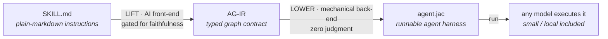

<div align="center">
  <picture>
    <source media="(prefers-color-scheme: dark)" srcset="docs/assets/logo-lockup.png">
    
  </picture>
  <p><strong>The skill compiler — <code>SKILL.md</code> in, a typed agent harness out.</strong></p>
  <p>
    <a href="https://github.com/sigilagent/sigil/actions/workflows/ci.yml"></a>
    <a href="https://github.com/sigilagent/sigil/releases/latest"></a>
    <a href="https://www.npmjs.com/package/@sigilagent/sigil"></a>
    <a href="LICENSE"></a>
    <a href="https://sigilagent.com"></a>
    <a href="https://sigilagent.com/reference/"></a>
    <a href="https://arxiv.org/abs/2607.27309"></a>
  </p>
  <p>
    <a href="https://www.jaseci.org/"> &nbsp;<b>built with Jac</b></a>
  </p>
</div>

Most agent harnesses treat a skill as a prompt: the model reads your instructions
and you *hope* it follows them. A frontier model mostly will. A small, cheap, or
fully-local model skips steps, ignores the MUSTs, and quietly drops the
verification you asked for.

Sigil **compiles** the skill instead of prompting it. You write the same
plain-markdown `SKILL.md` you already write, and the compiler turns it into a
typed program the model runs *inside*:

- mandatory steps become graph **nodes** the run must visit, in the skill's order;
- prohibitions become **constraints** with no edge to traverse;
- code snippets become runnable **tool bodies**;
- verification steps become **gates** with typed verdicts.

The model's judgment is boxed into typed slots, only at the points where the skill
actually calls for judgment. The structure a weak model would skip is no longer
skippable — which is why a compiled skill runs faithfully on a small, cheap, even
fully-local model.

```bash
sigil compile ./SKILL.md -e agent.jac    # SKILL.md  →  one runnable agent
./agent.jac "extract the tables from report.pdf"
SIGIL_MODEL=ollama_chat/qwen3:8b ./agent.jac "..."   # any model can run it
```

<table align="center"><tr>
<td width="50%"></td>
<td width="50%"></td>
</tr><tr>
<td align="center"><sub><b>Compiling</b> is a live build view — every stage, with counts and timing.</sub></td>
<td align="center"><sub><b>Running</b> a compiled skill is a terminal app — node-by-node, with its output.</sub></td>
</tr></table>

## Two ways in

- **Use it** — install the release and drive the `sigil` CLI. See [Install](#install).
- **Read / hack it** — clone and run the tree from source, with step-by-step
  dumpers, breakpoints, and a visual pipeline explorer. See
  [Run from source](#run-from-source--watch-every-stage).

## Install

```bash
curl -fsSL https://github.com/sigilagent/sigil/releases/latest/download/install.sh | bash
# or
npm install -g @sigilagent/sigil
```

macOS and Linux. Both land the same release in `~/.sigil/app`: the npm package is a
launcher whose first run performs that install, pinned to the package's version, so
`npm update -g @sigilagent/sigil` is how an npm install moves to the next release.

On Windows, run this in PowerShell:

```powershell
irm https://github.com/sigilagent/sigil/releases/latest/download/install.ps1 | iex
```

jac has no Windows build yet, so Sigil runs in Docker Desktop or WSL2, and you get a
`sigil` command that forwards to it. See [docs/reference/windows.md](docs/reference/windows.md).

The installer compiles Sigil once, so the first command starts warm. On a fresh
install at a terminal it then connects a model (`sigil setup`), asks whether Sigil
should start when you log in, and starts it: the scheduler plus the Observatory
at http://localhost:8199. `sigil update` recompiles and restarts whatever was
running.

Connecting a model is required: setup will not finish without one, and three of the routes
need no API key: sign in with ChatGPT and your ChatGPT plan pays; use the Claude
Code CLI you already have; or run models locally with Ollama. OpenRouter is a
browser sign-in too, and pasting an OpenAI, Anthropic, Gemini or Z.ai key works as
before.

```bash
sigil setup                                  # connect a model (required), pick the tiers
sigil connect chatgpt                        # …or connect one route directly
sigil connections                            # what is connected, and which tiers can run
```

```bash
sigil compile ./SKILL.md -e agent.jac        # the compiler, end to end
sigil solve "turn report.pdf into clean CSV" # the agent: compile on miss, reuse on hit
sigil library                                # the compiled skills, with run stats
sigil                                        # chat: the conversational agent over the same graph
```

Models are configured on the graph: `sigil setup` points the tiers at what you
connected, and `sigil models set <tier> <name>` changes one. A fresh graph seeds
them from `SIGIL_FRONTIER`, `SIGIL_SMALL` and `SIGIL_ROUTER`. An ejected runnable
picks its model from `SIGIL_MODEL`. Details:
[`docs/reference/connections.md`](docs/reference/connections.md).

## How the compiler works

The pipeline splits where a traditional compiler does: a front-end that owns all
the judgment, and a back-end that owns none.



The **AG-IR** in the middle is one typed graph read four ways: the step flowchart,
the control-flow graph, the dataflow of typed carries, and the knowledge/tool
residency map. Its primitives are closed, and each has exactly one lowering — that
is what lets the back-end be deterministic.

**LIFT** (the AI front-end) is anchored by the spec loop: a model extracts
candidate rules, and a deterministic grounding check drops any rule whose quote is
not verbatim in the skill, so a hallucinated rule can never survive. Coverage
critics hunt for dropped obligations, and a code audit catches modality drift.
Then the gates check the result — the SIGIL paper's validation checks G1–G6, then
COMPILE, the compile oracle, which round-trips every candidate IR through the
mechanical back-end and the `jac` type-checker. Repair comes first: mechanical
autofixes, then scoped model repair, then faithful degradation, and whatever
remains rides the result as typed findings. A compile fails when no runnable module
exists, or when an error finding survives that repair budget, and `--strict`
restores fail-on-any-finding for CI.

Compiling interactively also offers to lint the skill first. Obligations the spec
loop found underspecified or self-contradictory come back as findings, and your
one do / maybe / don't answer both settles the obligation and writes the sentence
that encodes it durably into the `SKILL.md`. Standalone:
`sigil lint <SKILL.md> [--fix]`.

Full walkthrough: [`src/compiler/README.md`](src/compiler/README.md) and
[`docs/reference/skill-compilation.md`](docs/reference/skill-compilation.md).

## Run from source — watch every stage

Sigil runs straight from a checkout; `install.sh` only copies a release into
`~/.sigil/app`. To read, debug or extend the compiler, install the *jac runtime* —
**not Sigil as a package**. jac is a **self-contained native binary** (NOT a pip
package — `pip install jaclang` is a different, older project), pinned to the
version in `jac.toml`:

```bash
# the pinned jac runtime → ~/.local/bin/jac  (the repo's ./install.sh does this too)
curl -fsSL https://raw.githubusercontent.com/jaseci-labs/jaseci/main/scripts/install.sh \
  | bash -s -- --version 0.37.25
export PATH="$HOME/.local/bin:$PATH"
jac --version                    # → jac 0.37.25
jac install                      # provision jac.toml deps (pyyaml, litellm, …)
```

Then drive the tree in place — `./sigil compile ./SKILL.md`, or
`jac run src/main.jac -- …`.

The jac binary bundles its own Python, so it needs no conda env. A conda env is
only for the Python-side tooling (e.g. SkillsBench, run on **Python 3.12**):
`conda create -n sigil python=3.12`.

### Dump each back-end stage (no model)

The LOWER back-end (AG-IR → validation → JAC) is deterministic and needs no model.
This prints each stage's input and output on a shipped example (`examples/csv-clean`):
the AG-IR text, its parsed structure, the gate findings, the lowered JAC, and the
COMPILE verdict.

```bash
jac run src/debug_pipeline.jac    # AG-IR → load_agir → gates → transpile_ir → compile_gate
```

**Breakpoints.** jac is a standalone binary with no importable `jaclang`, so you
debug with **pdb**, not an IDE's graphical debugger: drop `breakpoint();` into any
`.jac` (e.g. inside `transpile_ir`) and run `jac run …` — it drops to pdb right
there (works inside PyCharm's integrated terminal too). IDE breakpoints set on a
`.jac` file do not bind; for `.jac` syntax/LSP use VS Code's Jac extension.

### Visualize one real skill

`src/export_bundle.jac` compiles a skill and writes a `bundle.json`; its front-end
(SKILL.md → rules → AG-IR) needs a connected model (see Environment below):

```bash
jac run src/export_bundle.jac -- examples/csv-clean/SKILL.md bundle.json
open tools/pipeline-explorer/index.html      # then click: load bundle.json
```

The explorer (`tools/pipeline-explorer/index.html`) is self-contained and ships a
synthetic demo, so it also opens with no model. Its components:

1. **SKILL.md** — the source text; a rule's verbatim span highlights on selection.
2. **Requirements** — the extracted contract: each rule's id, kind, modality, quote.
3. **AG-IR** — the dependency graph; click a node for its `reads` / `writes` and the
   requirement + source span it `traces_to`.
4. **JAC** — the lowered code; a node's `can n_<id>` lines highlight with it.
5. **Validation** — pass, or each failing gate explained (offending node /
   requirement / carry) with the `jac check` error.

Select anything in any column and the matching source span, requirement, graph
node, JAC lines and findings all highlight together. Details:
[`tools/pipeline-explorer/README.md`](tools/pipeline-explorer/README.md).

### Environment

The LIFT front-end needs a model; the back-end dumpers do not. Put keys and any
relay/proxy (中转) base URL in a gitignored `.env` (copy `.env.example`). The
`sigil` launcher does not auto-source it, so run from the repo root (litellm
auto-loads `.env`) or `set -a; source .env; set +a` first. Precedence is shell env
> `.env` > `jac.toml` defaults — any of these can just be exported in the shell:

| variable | overrides |
|---|---|
| `OPENAI_API_KEY` / `OPENAI_API_BASE` | model key and relay base URL — then use `openai/<model>` names |
| `SIGIL_MODEL` | the model an ejected `./agent.jac` runs on |
| `SIGIL_FRONTIER` / `SIGIL_SMALL` / `SIGIL_ROUTER` | tier seeds for a fresh graph |
| `SIGIL_JAC` / `SIGIL_JAC_CHECK` | which `jac` binary to use / skip the pinned-version check |
| `AGIR_PROGRESS=1` | stream the node trace while a compiled skill runs |

## Reproducing the paper's numbers

The paper reports three axes. Where each comes from, and what is in this repo:

- **Test pass rate** — the agent's output scored by each task's own verifier. That
  harness is **[SkillsBench](https://github.com/benchflow-ai/skillsbench)** (Python
  3.12, `uv`); it reports `reward` (1/0) per task, run **with** vs **without** the
  skill:

  ```bash
  git clone https://github.com/benchflow-ai/skillsbench && cd skillsbench
  uv tool install benchflow && uv sync --locked
  bench eval run --tasks-dir tasks/<task> --agent <agent> --model <model> \
    --skill-mode with-skill --skills-dir tasks/<task>/environment/skills/ --sandbox docker
  # …and --skill-mode no-skill for the baseline
  ```

- **Skill adherence** — the fraction of a task's applicable mandates the run
  realized. The paper scores it with a GPT-5 judge over (task, the compiled
  AG-IR / harness, the execution trace) against a reviewed reference mandate DAG
  (paper Appendix D); an in-repo code-certified variant is sketched in
  [`docs/compliance-to-100.md`](docs/compliance-to-100.md). **This scorer is not
  publicly released** — only the compiler is (checked: the `sigilagent` org and
  the arXiv page). From here the raw material is the AG-IR mandates (rules +
  `traces_to`), the node trace (`AGIR_PROGRESS=1 ./agent.jac …`), and the gates;
  scoring on top of them is yours to build.

- **Token cost** — Sigil accounts tokens per run; `sigil library` and the
  Observatory (`sigil serve`) show them. SkillsBench's `reward` does not include
  tokens.

SkillsBench runs a named `--agent` (oracle / claude-agent-acp / gemini / codex-acp)
against a task and has no built-in hook for a compiled artifact, so its with-skill
arm gives a model the raw `SKILL.md`; wiring an ejected `./agent.jac` in as the
agent is your own adapter. For the one-artifact direct-run method, see
[`docs/skillsbench-compiler-bugs.md`](docs/skillsbench-compiler-bugs.md).

## Works with Claude Code — both directions

Sigil plugs into the harness you already use, and needs no API key to do it.
Compile on the `claude` CLI you already have, then serve every skill you compile
back into it as a tool.

```bash
sigil --claude compile ./SKILL.md          # compile on your Claude subscription
claude mcp add sigil -- sigil mcp-serve    # each compiled skill → a Claude Code tool
```

Claude Code decides *when*; the compiled harness decides *how*. A skill loaded
into context is advice the model may follow. Behind one of these tool calls
there is no prompt left to drift from.

byLLM dispatches through litellm, and litellm lets you own a provider prefix, so
a headless `claude -p` is just another model — typed returns and tool-using slots
included. Each compiled skill becomes one MCP tool, triggered by the skill's own
`description:` frontmatter and carrying its run record. When a compile fails its
gate, a tool-using session gets the workspace and the compile oracle as a command
(`sigil gate`) and iterates until it passes; the oracle stays the authority.

Details: [`docs/reference/claude-code.md`](docs/reference/claude-code.md).

## Ejecting

A compiled skill leaves Sigil in two shapes.

```bash
sigil compile ./SKILL.md -e agent.jac        # one file, one task
./agent.jac "extract the tables from report.pdf"
./agent.jac --input_pdf=report.pdf           # or bind typed inputs directly
./agent.jac --mcp                            # or serve itself as an MCP tool server
```

The generated module embeds its full runtime helper library, so the artifact is a
single executable `.jac` that runs anywhere a `jac` binary goes — no sigil, no
session, no graph. `--mcp` makes it a stdio JSON-RPC server that invokes the
skill in-process, with the tool schema derived from the artifact's own typed
inputs.

```bash
sigil eject-agent clean_csv ./csvbot         # …or a whole agent: memory, cron,
cd csvbot && ./csvbot daemon start           #    channels, a daemon of its own
```

An ejected agent has its own soul, memory, schedule and channels — a peer of the
Sigil that made it, not a client. It runs the skills it shipped with and cannot
author new ones. See [`docs/reference/ejecting-agents.md`](docs/reference/ejecting-agents.md).

## The agent around the compiler

The compiler is the core; Sigil also ships a persistent agent built on it. The
agent is an object-spatial graph — its skills are compiled `TaskGraph`s, its
memory and config are nodes, and `solve` routes every task through them. On a hit
it runs the compiled skill on the small model; on a miss the frontier model
compiles a new one and persists it. The expensive model is paid once per class of
task, and the cheap model rides it forever. Memory is three graph-native layers:
procedural (the compiled skills), episodic (`Attempt` nodes — every run and its
outcome), and semantic (`Memory` nodes — durable facts, injected at execution
time so the compiled procedure stays class-general).

Every compiled skill is also a **tool** on that agent — `skill_<signature>`,
triggered by the skill's own description, on the chat agent, its sub-agents, and
inside other compiled skills. Nobody has to say "use the csv-clean skill"; the
tool list says it exists and what it is for. Both gates stay the operator's: the
tool policy decides whether a skill is offered at all, and the exec-approval gate
asks before the agent starts one on its own.

Around that: chat (a tool-using ReAct agent with file, shell and web tools behind
an exec-approval gate), MCP tool servers, Discord / Telegram / WhatsApp / Slack
channels, cron jobs as real graph nodes, and a web console — `sigil serve` —
for compiling skills, running them and watching every run's tokens.

## Layout

```
observatory.jac          full-stack server entrypoint — API + web UI
                         (root: jac derives the client entry from the basename)
src/
  main.jac               CLI entrypoint (compile / solve / chat / serve / …)
  compiler/              THE COMPILER
    ai/                    LIFT: spec_loop · workflow · flows · assemble · gates · repair · eject
    mechanical/            LOWER: the AG-IR → OSP transpiler + runtime assets
  contracts/             the AG-IR standard (primitives · authoring contract)
  sigil.jac              graph model + routing + the compile/execute cognition
  chat_agent.jac         the conversational ReAct agent
  sigil_skill_tools.jac  every compiled skill as a gated tool on that agent
  sigil_workspace.jac    tool-belt: file tools, gated exec, SSRF-guarded web
  debug_pipeline.jac     step-by-step dumper for the back-end stages (see above)
  export_bundle.jac      compile a skill → bundle.json for the pipeline explorer
web/                     the web console (one module per page)
tools/pipeline-explorer/ self-contained visual explorer of the compile pipeline
tools/sandbox/           containerized harness for running compiled agents
.jac/data/               (runtime) the persistent graph
```

The user reference lives in [`docs/reference/`](docs/reference/) — loaded at
runtime by the agent itself, so what you read is exactly what Sigil reads to
answer questions about itself.

## Status

The compiler is built and verified end to end: the gated LIFT converges on
MockLLM-driven tests, the compile oracle round-trips real AG-IRs through the
mechanical half with a clean `jac check`, and ejected runnables execute
standalone. The graph runtime — routing, soul/memory/config lifecycle, chat,
cron, channels, Observatory — is built and tested.

## Paper

The design and evaluation behind Sigil are written up in
**[SIGIL: Compiling Agent Skills into Typed Harnesses](https://arxiv.org/abs/2607.27309)**
— compiled skills execute 86% of mandated steps versus 56% for the same skill
read as a prompt, at 0.58× the tokens.

```bibtex
@misc{dantanarayana2026sigil,
  title         = {SIGIL: Compiling Agent Skills into Typed Harnesses},
  author        = {Dantanarayana, Jayanaka and Kashmira, Savini and Tang, Lingjia and Mars, Jason},
  year          = {2026},
  eprint        = {2607.27309},
  archivePrefix = {arXiv},
  primaryClass  = {cs.SE},
  doi           = {10.48550/arXiv.2607.27309},
  url           = {https://arxiv.org/abs/2607.27309}
}
```
